<div align="center">

<a href="https://github.com/ishandutta2007/Awesome-Awesome-Awesome"></a><a href="https://discord.gg/jc4xtF58Ve"></a>
<a href="https://github.com/ishandutta2007/Awesome-Survey-Feedback-Management/stargazers"></a>
<a href="https://github.com/ishandutta2007/Awesome-Survey-Feedback-Management/network/members"></a>
<a href="https://github.com/ishandutta2007/Awesome-Survey-Feedback-Management/blob/main/LICENSE"></a>
<a href="https://github.com/ishandutta2007/Awesome-Survey-Feedback-Management/pulls"></a>
<a href="https://github.com/ishandutta2007"></a>

<br/><br/>

<a href="https://github.com/ishandutta2007/Awesome-Survey-Feedback-Management">
  
</a>

# 📊 Awesome Survey & Feedback Management

**A curated index of top-tier SaaS platforms, enterprise experience management engines, and high-performance open-source survey tools.**

[](#-sector-overview--market-dynamics)
[](#-how-to-contribute)
[](#-open-source-github-projects)

</div>

---

## 📑 Table of Contents

- [🌟 Introduction & SEO Meta](#-introduction--seo-meta)
- [🌐 Sector Overview & Market Dynamics](#-sector-overview--market-dynamics)
- [🏢 SaaS & Hosted Commercial Platforms](#-saas--hosted-commercial-platforms)
  - [📊 SaaS Market Comparison Table](#-saas-market-comparison-table)
  - [🔍 In-Depth SaaS Profiles](#-in-depth-saas-profiles)
- [💻 Open-Source GitHub Projects](#-open-source-github-projects)
  - [⭐ Open-Source Star Leaderboard](#-open-source-star-leaderboard)
  - [🛠️ Detailed Open-Source Project Breakdown](#️-detailed-open-source-project-breakdown)
- [🏗️ Survey Architecture & Selection Playbook](#️-survey-architecture--selection-playbook)
- [🤝 How to Contribute](#-how-to-contribute)
- [⭐ Star History](#-star-history)
- [💖 Support & Sponsoring](#-support--sponsoring)
- [📜 License & Disclaimer](#-license--disclaimer)

---

## 🌟 Introduction & SEO Meta

Welcome to the definitive repository for **Survey & Feedback Management**, **Voice of Customer (VoC)**, **Customer Experience (CX)**, and **Enterprise Feedback Architecture**.

Whether you are an engineering team needing **self-hosted headless survey infrastructure** to preserve strict GDPR/HIPAA data sovereignty, a product manager measuring **Net Promoter Score (NPS)** and in-app CSAT micro-surveys, or an enterprise research department orchestrating complex longitudinal studies, this index aggregates the most effective solutions across commercial and open-source ecosystems.

### 🔑 Key Topic Coverage
* **Core Disciplines:** Online Survey Software, Customer Feedback Loops, Form Builders, Experience Management (XM), 360-degree Employee Feedback, Market Research Panels.
* **Architecture Models:** Headless Surveys, Webhook Event Streams, React/Vue Embeddable Form Renderers, Native Salesforce Data Residency, Self-Hosted Docker/Kubernetes Deployments.
* **Standard Metrology:** Net Promoter Score (NPS), Customer Satisfaction Score (CSAT), Customer Effort Score (CES), AI Sentiment Categorization.

---

## 🌐 Sector Overview & Market Dynamics

The global **Online Survey and Feedback Management Market** is valued at approximately **$3.5 Billion to $6.4 Billion** (2024–2025) and is projected to expand rapidly to over **$15.0 Billion to $25.0 Billion by 2030**, progressing at a Compound Annual Growth Rate (CAGR) between **14.0% and 18.2%**. Growth is intensely accelerated by omnichannel digital transformation, real-time product analytics integration, and automated NLP-driven sentiment analysis on open-ended feedback.

### 🧩 Market Fragmentation & Competitive Anatomy
* **Moderately-to-Highly Fragmented (Not Winner-Take-All):** While enterprise experience management giants (such as Qualtrics and SurveyMonkey) command significant market valuation and brand equity in traditional corporate research, the broader sector remains fragmented across distinct buyer paradigms:
  1. **Enterprise Experience Management (XM):** Multi-million dollar institutional suites focused on continuous cross-silo listening (Qualtrics, Medallia).
  2. **Product-Led Form Experiences:** Conversational, design-centric tools prioritizing respondent completion rates and viral branding (Typeform, SurveySparrow).
  3. **Operational Workflow & Compliance Form Engines:** Deep database, document generation, and CRM-native builders (Jotform, Formstack, Zoho Survey).
  4. **Self-Hosted & Headless Open-Source Infrastructure:** Modern privacy-first, developer-centric platforms (Formbricks, SurveyJS, Typebot) that counter escalating per-response SaaS taxation and keep sensitive customer telemetry within private cloud borders.

---

## 🏢 SaaS & Hosted Commercial Platforms

Below is the benchmarked matrix of leading commercial survey and feedback platforms, sorted in **descending order by company scale (valuation or annual revenue)**.

### 📊 SaaS Market Comparison Table

| 🏢 Platform | 📈 Company Scale (Valuation / Revenue) | 💳 Starting Paid Tier Price | 🎁 Free Tier & Trial Limits | ✨ Core Focus & Differentiator | 🔗 Official Link |
| :--- | :--- | :--- | :--- | :--- | :--- |
| **Google Forms** | **~$2.1 Trillion Market Cap** / $307B+ Revenue *(Alphabet)* | **$0.00** *(Standalone forms 100% free)* / **$6.00/user/mo** *(Google Workspace Starter)* | **Free forever**: Unlimited forms, questions, and responses; capped only by standard 15 GB Google Drive storage | Simplest frictionless data collection; instant native sync into Google Sheets | [Visit Google Forms](https://forms.google.com/) |
| **Qualtrics** | **$13.0 Billion Valuation** *(Silver Lake / CPP)* / ~$1.5B Revenue | **$420.00/month** *($5,040/yr billed annually for Strategic Research; Enterprise XM from $25,000+/yr)* | **Free forever sandbox**: Lifetime cap of 500 total responses, max 3 active surveys, 30 questions/survey, web-link distribution only (no email distributions, no exports) | The enterprise gold standard in XM, Stats iQ correlation analysis, and Text iQ sentiment NLP | [Visit Qualtrics](https://www.qualtrics.com/) |
| **SurveyMonkey** | **$1.5 Billion Valuation** *(STG)* / ~$380 Million+ ARR | **$25.00/user/mo** *(Team Advantage, billed annually, min 3 users)* or **$39.00/mo** *(Standard Individual)* | **Free Basic Plan**: Unlimited surveys, up to 10 questions per survey, 40 viewable responses per survey (excess responses locked), no CSV/Excel exports | Trusted global benchmarking panel (335M+ panel respondents across 130+ nations) | [Visit SurveyMonkey](https://www.surveymonkey.com/) |
| **Zoho Survey** | **$1.1+ Billion Revenue** *(Zoho Corporation Suite)* | **$10.00/month** *(Basic tier)* or **$20.00/mo** *(Plus tier, billed annually at $240/yr)* | **Free forever**: Unlimited surveys (max 3 active concurrently), 10 questions/survey, 100 responses/survey, real-time reports & CSV export | Native two-way data sync across 50+ Zoho CRM/ERP business apps; 90+ survey translation languages | [Visit Zoho Survey](https://www.zoho.com/survey/) |
| **Jotform** | **~$1.0+ Billion Est. Valuation** / ~$145 Million+ ARR | **$34.00/month** *(Bronze Plan, billed annually at $408/yr)* or **$39.00/mo** *(Monthly)* | **Starter Free Plan**: Free forever with 5 active forms, 100 monthly submissions, 10 payment submissions, 100 MB storage, Jotform branding | Massive drag-and-drop workflow suite: PDF form automation, e-signatures, tables, and Jotform Apps | [Visit Jotform](https://www.jotform.com/) |
| **Typeform** | **$935 Million Valuation** *(Series C)* / ~$90 Million ARR | **$25.00/month** *(Basic Plan, billed annually at $300/yr)* or **$29.00/mo** *(Monthly)* | **Free Plan**: Free forever with 3 forms, 10 questions per form, and 10 responses per month total, Creator AI trial, Typeform branding | High-completion conversational one-question-at-a-time design with adaptive AI follow-ups | [Visit Typeform](https://www.typeform.com/) |
| **Formstack** | **~$400 Million Valuation** *(Silversmith)* / ~$45 Million ARR | **$83.00/month** *(Forms Plan, billed annually at $996/yr)* or **$99.00/mo** *(Monthly)* | **14-day free trial**: Full access to forms engine, 1,000 submissions/form, no credit card required upfront *(No permanent free tier)* | Native Salesforce data architecture where no collected data leaves the Salesforce security trust boundary | [Visit Formstack](https://www.formstack.com/) |
| **QuestionPro** | **~$55 Million+ ARR** *(Bootstrapped & Private)* | **$99.00/user/mo** *(Advanced Plan, billed annually at $1,188/yr for 25k responses/yr)* | **Free Essentials Plan**: Free forever with unlimited surveys, unlimited questions, up to 200 responses per survey, basic branching logic | Generous perpetual free quota, AI survey authoring, and Model Context Protocol (MCP) tool support | [Visit QuestionPro](https://www.questionpro.com/) |
| **Alchemer** | **~$45 Million+ ARR** *(Majority owned by K1)* | **$55.00/user/mo** *(Collaborator Plan, billed annually at $660/yr)* or **$165.00/quarter** | **14-day free trial**: Full feature trial for up to 3 test surveys and 200 responses *(No permanent free tier)* | Deep survey engineering: 43 question types, advanced looping/piping logic, complex bi-directional CRM integration | [Visit Alchemer](https://www.alchemer.com/) |
| **SurveySparrow** | **~$10 Million ARR** *(Venture-backed)* | **$19.00/month** *(Basic Plan, billed annually at $228/yr)* or **$39.00/mo** *(Quarterly)* | **Free Plan**: Free forever with 3 active surveys, 10 questions/survey, 75 responses per quarter *(Includes 14-day Business tier trial)* | Mobile-first messaging and chat-style surveys with automated recurrence schedules | [Visit SurveySparrow](https://surveysparrow.com/) |

---

### 🔍 In-Depth SaaS Profiles

#### 1. [Google Forms](https://forms.google.com/) 📄
* **Parent Organization:** Alphabet Inc. (`$2.1T Market Cap`)
* **Pricing Snapshot:** Free for personal accounts; Included with **Google Workspace Business Starter at $6.00/user/month**.
* **Free Tier Allowance:** Free forever with no response limits, no question caps, and no expiration date.
* **Why Choose It:** If you need zero-friction, reliable survey distribution with collaborative real-time Google Sheets analysis and zero operational overhead.

#### 2. [Qualtrics](https://www.qualtrics.com/) 🏛️
* **Parent Organization:** Silver Lake & CPP Investments (`$13B Valuation`)
* **Pricing Snapshot:** Self-service Strategic Research begins at **$420.00/month** ($5,040/year); Enterprise CustomerXM packages start from **$25,000/year to $50,000+/year**.
* **Free Tier Allowance:** Free sandbox capped at 500 lifetime responses across 3 active surveys; advanced stats, exports, and automated emails restricted.
* **Why Choose It:** Unmatched analytical rigor for multi-national brands, academic research bodies, and corporate HR departments requiring cross-sectional statistical analysis.

#### 3. [SurveyMonkey](https://www.surveymonkey.com/) 🐒
* **Parent Organization:** Symphony Technology Group (`$1.5B Valuation`)
* **Pricing Snapshot:** Team Advantage starts at **$25.00/user/month** (annual, 3 seats min) or **$39.00/month** for Individual Standard.
* **Free Tier Allowance:** Free Basic tier provides unlimited surveys with 10 questions each, but caps response visibility at 40 responses per survey with exports blocked.
* **Why Choose It:** When your project requires third-party sample panels, proven industry benchmarking data, and team-friendly survey authoring.

#### 4. [Zoho Survey](https://www.zoho.com/survey/) 🌐
* **Parent Organization:** Zoho Corporation (`$1.1B+ Global Suite Revenue`)
* **Pricing Snapshot:** Basic tier starts at **$10.00/month**; Plus tier is **$20.00/month** billed annually.
* **Free Tier Allowance:** Free forever plan supports 3 active surveys, 10 questions per survey, 100 responses per survey, and CSV data exports.
* **Why Choose It:** Cost-effective corporate survey automation deeply integrated into CRM, Helpdesk, and ERP workflows within the Zoho ecosystem.

#### 5. [Jotform](https://www.jotform.com/) 📋
* **Company Status:** Bootstrapped & Privately Held (`~$1B Est. Valuation / ~$145M ARR`)
* **Pricing Snapshot:** Bronze Plan begins at **$34.00/month** (annual billing at $408/year) or **$39.00/month** (monthly).
* **Free Tier Allowance:** Starter tier offers 5 active forms, 100 monthly submissions, 10 payment submissions, and 100 MB file storage permanently.
* **Why Choose It:** Beyond surveys, Jotform provides an entire operational toolkit including drag-and-drop mobile apps, approval workflows, and HIPAA-compliant healthcare intake.

#### 6. [Typeform](https://www.typeform.com/) ✍️
* **Company Status:** Venture-Backed (`$935M Valuation / ~$90M ARR`)
* **Pricing Snapshot:** Basic tier begins at **$25.00/month** (annual billing at $300/year) or **$29.00/month** (monthly) for 100 responses/month.
* **Free Tier Allowance:** Free tier allows 3 forms, 10 questions per form, and 10 responses per month total.
* **Why Choose It:** When brand perception, respondent delight, and completion rates are your highest priorities.

#### 7. [Formstack](https://www.formstack.com/) 🏢
* **Company Status:** Silversmith Capital Backed (`~$400M Valuation / ~$45M ARR`)
* **Pricing Snapshot:** Forms Plan begins at **$83.00/month** (annual billing at $996/year) or **$99.00/month** (monthly).
* **Free Tier Allowance:** 14-day free trial with up to 25 forms and 1,000 submissions per form; no perpetual free plan.
* **Why Choose It:** Mission-critical healthcare and finance systems requiring native Salesforce schema bindings and strict HIPAA/GDPR guarantees.

#### 8. [QuestionPro](https://www.questionpro.com/) 🤖
* **Company Status:** Bootstrapped & Privately Held (`~$55M ARR`)
* **Pricing Snapshot:** Advanced Plan begins at **$99.00/user/month** (annual billing at $1,188/year) with 25,000 responses/year.
* **Free Tier Allowance:** Free Essentials plan offers unlimited surveys, unlimited questions, and 200 responses per survey with 30+ question types.
* **Why Choose It:** Generous perpetual allowances combined with cutting-edge AI prompt-to-survey generation and LLM tool connectivity.

#### 9. [Alchemer](https://www.alchemer.com/) 🧪
* **Company Status:** K1 Investment Management (`~$45M ARR`)
* **Pricing Snapshot:** Collaborator Plan starts at **$55.00/user/month** (billed annually) or **$165.00/quarter**.
* **Free Tier Allowance:** 14-day full platform evaluation trial supporting up to 3 surveys and 200 responses.
* **Why Choose It:** Complex survey logic, nested piping, custom scripting, and deep bi-directional enterprise data connectors.

#### 10. [SurveySparrow](https://surveysparrow.com/) 🐦
* **Company Status:** Venture-Backed (`~$10M ARR`)
* **Pricing Snapshot:** Basic Plan begins at **$19.00/month** (annual billing at $228/year) or **$39.00/month** (quarterly) for 2,500 responses/year.
* **Free Tier Allowance:** Free forever plan provides 3 active surveys, 10 questions per survey, and 75 responses per quarter.
* **Why Choose It:** Mobile-optimized, chat-style survey sequences designed to gather high-engagement pulse feedback from employees and customers.

---

## 💻 Open-Source GitHub Projects

Open-source survey and feedback systems give engineering teams complete data ownership, eliminate per-seat or per-response licensing fees, and prevent vendor lock-in.

The list below is **sorted strictly in descending order by GitHub stargazers count**. Each project includes a live white-themed social Stars_Badge linking directly to that repository's stargazers page.

### ⭐ Open-Source Star Leaderboard

| 🏅 Rank | 📦 Repository & Link | ⭐ GitHub Stargazers Badge | 📜 License | 🛠️ Architecture / Stack | 🎯 Core Niche |
| :---: | :--- | :---: | :---: | :--- | :--- |
| **#1** | **[Formbricks](https://github.com/formbricks/formbricks)** | [](https://github.com/formbricks/formbricks/stargazers) | AGPL-3.0 | Next.js, TypeScript, Tailwind, Prisma | Headless survey infrastructure & open-source Qualtrics alternative |
| **#2** | **[Typebot](https://github.com/baptisteArno/typebot.io)** | [](https://github.com/baptisteArno/typebot.io/stargazers) | AGPL-3.0 | Next.js, React, Node.js, Prisma | Conversational form & chatbot engine with visual block builder |
| **#3** | **[HeyForm](https://github.com/heyform/heyform)** | [](https://github.com/heyform/heyform/stargazers) | AGPL-3.0 | Node.js, React, MongoDB, Redis | Typeform open-source alternative with interactive form builder |
| **#4** | **[SurveyJS Library](https://github.com/surveyjs/survey-library)** | [](https://github.com/surveyjs/survey-library/stargazers) | MIT | TypeScript, React, Angular, Vue, Vanilla JS | Client-side zero-leakage form & survey UI component library |
| **#5** | **[Fider](https://github.com/getfider/fider)** | [](https://github.com/getfider/fider/stargazers) | AGPL-3.0 | Go, React, PostgreSQL | Customer feedback board for feature requests, voting, and prioritization |
| **#6** | **[SurveyKing](https://github.com/javahuang/SurveyKing)** | [](https://github.com/javahuang/SurveyKing/stargazers) | Apache-2.0 | Java, Spring Boot, React, Ant Design | Lightweight self-hosted alternative to SurveyMonkey with workflow exams |
| **#7** | **[OpnForm](https://github.com/OpnForm/OpnForm)** | [](https://github.com/OpnForm/OpnForm/stargazers) | AGPL-3.0 | Laravel, PHP, Vue.js, Tailwind CSS | Open-source form builder with Notion-like editor and custom webhooks |
| **#8** | **[XiaoJuSurvey](https://github.com/didi/xiaoju-survey)** | [](https://github.com/didi/xiaoju-survey/stargazers) | Apache-2.0 | Node.js, NestJS, Vue 3, Element Plus | Enterprise-grade survey, quiz, and examination platform by Didi Global |
| **#9** | **[LimeSurvey](https://github.com/LimeSurvey/LimeSurvey)** | [](https://github.com/LimeSurvey/LimeSurvey/stargazers) | GPL-2.0 | PHP, MySQL/PostgreSQL, ExpressionScript | The most mature self-hosted survey platform with advanced academic logic |
| **#10** | **[TellForm](https://github.com/tellform/tellform)** | [](https://github.com/tellform/tellform/stargazers) | MIT | Node.js, Express, AngularJS, MongoDB | Classic open-source conversational form builder alternative to Typeform |
| **#11** | **[DWSurvey](https://github.com/wkeyuan/DWSurvey)** | [](https://github.com/wkeyuan/DWSurvey/stargazers) | AGPL-3.0 | Java, Spring Boot, MySQL, Vue.js | Enterprise survey assessment and questionnaire feedback system |
| **#12** | **[OhMyForm](https://github.com/ohmyform/ohmyform)** | [](https://github.com/ohmyform/ohmyform/stargazers) | AGPL-3.0 | Node.js, Express, Vue.js, Python | Minimalist, clean open-source form and survey creator with REST APIs |
| **#13** | **[Astuto](https://github.com/astuto/astuto)** | [](https://github.com/astuto/astuto/stargazers) | AGPL-3.0 | Ruby on Rails, Vue.js, PostgreSQL | Privacy-centric customer feedback tracker and roadmap prioritization board |
| **#14** | **[LogChimp](https://github.com/logchimp/logchimp)** | [](https://github.com/logchimp/logchimp/stargazers) | Apache-2.0 | Node.js, Express, Vue.js, PostgreSQL | Open-source Canny and ProductBoard alternative to capture user feedback |
| **#15** | **[EUSurvey](https://github.com/EUSurvey/EUSURVEY)** | [](https://github.com/EUSurvey/EUSURVEY/stargazers) | EUPL-1.2 | Java, Spring, Hibernate, Lucene | Official European Commission multilingual public consultation platform |

---

### 🛠️ Detailed Open-Source Project Breakdown

#### 1. [Formbricks](https://github.com/formbricks/formbricks) [](https://github.com/formbricks/formbricks/stargazers) 🧱
* **Overview:** The premier open-source survey infrastructure for modern software companies. Formbricks provides headless survey capabilities: trigger micro-surveys in your web/mobile app at specific user events, stream answers via webhooks into your data warehouse, and self-host without AGPL risk on front-end embedding packages.
* **Deployment:** Docker, Helm / Kubernetes, or single-click cloud deployment.
* **Best For:** Product teams embedding in-app CSAT, NPS, and cancellation surveys directly inside SaaS applications.

#### 2. [Typebot](https://github.com/baptisteArno/typebot.io) [](https://github.com/baptisteArno/typebot.io/stargazers) 💬
* **Overview:** High-performance conversational form builder that allows users to create chat-style surveys, lead capture sequences, and questionnaires using a visual node graph editor. Supports embeddable widgets, native webhooks, and AI blocks (OpenAI, Anthropic).
* **Deployment:** Docker Compose, Coolify, or Vercel + Supabase.
* **Best For:** Teams wanting conversational, interactive Typeform-like survey experiences with logic branching.

#### 3. [HeyForm](https://github.com/heyform/heyform) [](https://github.com/heyform/heyform/stargazers) 🎨
* **Overview:** A visually refined open-source form builder designed as a direct drop-in alternative to Typeform. Supports modern input types, complex conditional logic, customizable UI layouts, and exportable analytics.
* **Deployment:** Docker Compose.
* **Best For:** Design-conscious organizations wanting self-hosted, polished conversational forms.

#### 4. [SurveyJS](https://github.com/surveyjs/survey-library) [](https://github.com/surveyjs/survey-library/stargazers) ⚡
* **Overview:** Client-side JavaScript library that renders dynamic JSON-driven forms and surveys natively within your React, Angular, Vue, or Vanilla JS web applications. SurveyJS operates purely on the frontend and **never sends any data to external servers** — you determine your own API endpoints and encrypted database storage.
* **Deployment:** `npm install survey-core survey-react-ui` (or Angular/Vue packages).
* **Best For:** Regulated enterprises, healthcare systems, and banks needing absolute data sovereignty.

#### 5. [Fider](https://github.com/getfider/fider) [](https://github.com/getfider/fider/stargazers) 🗳️
* **Overview:** A lightweight, community-oriented feedback portal where users can submit suggestions, upvote existing ideas, and participate in discussion threads. Includes SSO (OAuth with Google, GitHub, Facebook), notification delivery, and staff moderation tools.
* **Deployment:** Docker image with PostgreSQL backend.
* **Best For:** Product teams needing a public or private feedback forum to prioritize their product roadmaps.

#### 6. [SurveyKing](https://github.com/javahuang/SurveyKing) [](https://github.com/javahuang/SurveyKing/stargazers) 👑
* **Overview:** A feature-complete survey, examination, and public questionnaire system with single-command Docker deployment. Features over 20 question types, time-limited tests, score calculation formulas, and approval workflows.
* **Deployment:** Single Docker container (`docker run javahuang/surveyking`).
* **Best For:** Internal HR teams, educational organizations, and IT administrators wanting an instant self-hosted SurveyMonkey replacement.

#### 7. [OpnForm](https://github.com/OpnForm/OpnForm) [](https://github.com/OpnForm/OpnForm/stargazers) 📝
* **Overview:** Modern open-source form platform featuring a Notion-style block editor. Includes logic jumps, custom domain support, email response triggers, Slack/Discord webhooks, and payment collection via Stripe.
* **Deployment:** Docker, Laravel Artisan environment.
* **Best For:** Solopreneurs, startups, and community builders who appreciate Notion-like authoring ergonomics.

#### 8. [XiaoJuSurvey](https://github.com/didi/xiaoju-survey) [](https://github.com/didi/xiaoju-survey/stargazers) 🚗
* **Overview:** Open-sourced by Didi Global (the mobility tech conglomerate), XiaoJuSurvey is an industrial-scale enterprise survey platform designed for high-concurrency questionnaires, exams, employee pulse surveys, and statistical data extraction.
* **Deployment:** Node.js / Docker with MySQL and Redis.
* **Best For:** High-volume enterprise installations handling millions of survey impressions.

#### 9. [LimeSurvey](https://github.com/LimeSurvey/LimeSurvey) [](https://github.com/LimeSurvey/LimeSurvey/stargazers) 🍋
* **Overview:** The veteran powerhouse of the open-source survey ecosystem. Provides unmatched statistical flexibility with ExpressionScript, token-based survey participant management, complex branching quotas, and support for over 80 natural languages.
* **Deployment:** Standard LAMP/LEMP stack or official Docker containers.
* **Best For:** Academic researchers, universities, polling agencies, and public sector organizations requiring rigorous statistical control.

#### 10. [TellForm](https://github.com/tellform/tellform) [](https://github.com/tellform/tellform/stargazers) ⛺
* **Overview:** An open-source alternative to Typeform and Google Forms with 11+ question categories, analytical dashboards, multi-lingual forms, and customizable theme settings.
* **Deployment:** Docker Compose with MongoDB.
* **Best For:** Teams looking for a lightweight, self-hosted conversational form engine.

#### 11. [DWSurvey](https://github.com/wkeyuan/DWSurvey) [](https://github.com/wkeyuan/DWSurvey/stargazers) 📊
* **Overview:** An established Java/Spring-based questionnaire and examination system providing a visual form editor, cross-tabulated reporting, conditional display rules, and mobile-responsive rendering.
* **Deployment:** Tomcat / Spring Boot JAR, Docker with MySQL.
* **Best For:** Enterprise Java development shops looking for an internal survey system.

#### 12. [OhMyForm](https://github.com/ohmyform/ohmyform) [](https://github.com/ohmyform/ohmyform/stargazers) ✏️
* **Overview:** Built by the open-source community to provide a privacy-preserving form engine. Includes support for custom themes, REST APIs, JSON data exports, and end-to-end data encryption.
* **Deployment:** Docker Compose.
* **Best For:** Developers desiring clean APIs and minimal server overhead.

#### 13. [Astuto](https://github.com/astuto/astuto) [](https://github.com/astuto/astuto/stargazers) 🦊
* **Overview:** A clean, privacy-focused open-source customer feedback tool written in Ruby on Rails. Allows customers to propose ideas, upvote feature requests, and follow development milestones on a public roadmap.
* **Deployment:** Docker with PostgreSQL.
* **Best For:** Privacy-first SaaS builders looking to replace Upvoty or Canny.

#### 14. [LogChimp](https://github.com/logchimp/logchimp) [](https://github.com/logchimp/logchimp/stargazers) 🐵
* **Overview:** Modern feedback tracking platform serving as an open-source alternative to Canny and ProductBoard. Helps product managers organize incoming user requests and align roadmaps with actual user demands.
* **Deployment:** Node.js with PostgreSQL or Docker.
* **Best For:** Product-led engineering teams tracking user feedback loops.

#### 15. [EUSurvey](https://github.com/EUSurvey/EUSURVEY) [](https://github.com/EUSurvey/EUSURVEY/stargazers) 🇪🇺
* **Overview:** The European Commission's official open-source consultation engine. Specifically engineered for public sector compliance, WCAG accessibility, 23 official EU language interfaces, and form translation across 136 ISO 639-1 languages.
* **Deployment:** Java Enterprise / WildFly application server with Oracle/PostgreSQL.
* **Best For:** Governments, regulatory agencies, and civic institutions running democratic public consultations.

---

## 🏗️ Survey Architecture & Selection Playbook

```
                  ┌────────────────────────────────────────────────┐
                  │    What is your Primary Architecture Need?     │
                  └───────────────────────┬────────────────────────┘
                                          │
            ┌─────────────────────────────┼─────────────────────────────┐
            ▼                             ▼                             ▼
   [ Complete Privacy &           [ Rapid Deployment &          [ Deep Analytics &
     Data Sovereignty ]             High Completion UX ]          Enterprise Scale ]
            │                             │                             │
    ┌───────┴───────┐             ┌───────┴───────┐             ┌───────┴───────┐
    ▼               ▼             ▼               ▼             ▼               ▼
 Headless/API    Self-Hosted    Conversational   Native CRM   Experience     Benchmarking
  Embeddable       Full App         Forms        Ecosystem    Management        Panels
    │               │             │               │             │               │
• SurveyJS      • LimeSurvey    • Typeform      • Formstack   • Qualtrics     • SurveyMonkey
• Formbricks    • SurveyKing    • Typebot       • Zoho Survey • Alchemer      • QuestionPro
                • Fider         • HeyForm
```

---

## 🤝 How to Contribute

Contributions from developers, researchers, and product teams are always welcome!

1. 🍴 **Fork the repository** on GitHub.
2. 🌿 **Create a dedicated branch:** `git checkout -b feature/add-new-tool`.
3. ✍️ **Add your platform or open-source tool** to `README.md` following the existing format. Include exact pricing tiers, free tier specifications, and live Stars_Count badges where applicable.
4. 🔍 **Verify links and formatting** to ensure valid markdown and clean table syntax.
5. 🚀 **Submit a Pull Request** with a concise summary of the additions.

---

## ⭐ Star History

[](https://star-history.dera.page/#ishandutta2007/Awesome-Survey-Feedback-Management&type=date&legend=top-left)

---

## 💖 Support & Sponsoring

Thank you for visiting and using **Awesome Survey & Feedback Management**!

If this curated ecosystem reference saved you hours of research, helped evaluate your tech stack, or supported your organization's tooling decisions, please consider supporting the project:

- ⭐ **Star this repository** to improve discoverability for others.
- 🍴 **Fork and contribute** your domain expertise or favorite tools.
- 📢 **Share this repository** on LinkedIn, X/Twitter, Reddit, and developer communities.
- ☕ **Sponsor or buy a coffee** to fund ongoing maintenance, benchmarks, and updates:  
  [](https://github.com/sponsors/ishandutta2007)  
  Direct support available on the [GitHub Sponsors Dashboard](https://github.com/sponsors/ishandutta2007).

---

## 📜 License & Disclaimer

* **License:** Distributed under the [MIT License](LICENSE).
* **Disclaimer:** All product names, trademarks, logos, and brands are the property of their respective owners. Company scale metrics and pricing are gathered from public filings, vendor pricing pages, and industry intelligence reports, subject to vendor revision.
